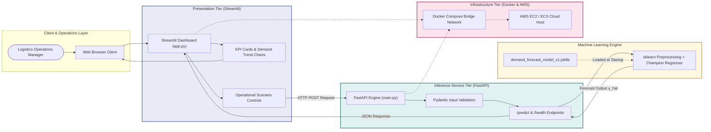

# End-to-End Machine Learning Project Report: Daily Demand Forecasting

**Project Title:** Daily Demand Forecasting for Logistics Operations  
**Document Type:** Comprehensive Technical Project Specification, Methodology, and Architectural Report  
**Target File Deliverable:** `DAILY_DEMAND_FORECASTING_COMPLETE_PROJECT_REPORT.md`  
**Author Role:** Senior Machine Learning Engineer, Data Science Project Analyst & Technical Documentation Specialist  
**Project Repository:** DemandCast AI  
**Status:** Architecture & Methodology Specification (Documentation Only — Pre-Implementation Phase)

---

## Executive Summary

This report establishes the rigorous technical design, data science methodology, and production deployment architecture for the **Daily Demand Forecasting** machine learning project. The project is governed by the academic and technical requirements outlined in the institutional assessment document (`Assignment_mini_project (1).docx`) and is evaluated against the concrete characteristics of the empirical dataset (`Daily Demand Forecasting Orders.csv`).

The primary business objective is to forecast total daily orders (`Target (Total orders)`) for a logistics distribution network across a sequential 60-day operational horizon. Accurate demand forecasting allows logistics managers to optimize warehouse staffing, fleet dispatching, dock scheduling, and inventory buffer allocations.

A foundational contribution of this document is the rigorous reconciliation between the supplied institutional assessment rubric—which primarily illustrates ML workflows using classification paradigms (e.g., confusion matrices, precision/recall, classification probabilities)—and the mathematical reality of the provided empirical dataset, which represents a continuous, ordered multivariate time-series regression task. This report bridges this gap without compromising the assessment's mandatory 16-stage pipeline, providing exact mathematical formulations, leakage-free feature engineering guidelines, chronological validation strategies, and an enterprise deployment architecture featuring FastAPI, Streamlit, Docker, and AWS cloud hosting.

---

## Table of Contents

1. [Section 1: Project Overview](#section-1-project-overview)
   - 1.1 Project Title and Context
   - 1.2 Problem Statement and Operational Motivation
   - 1.3 Project Objectives and Scope
   - 1.4 Expected Outcomes and Practical Use Cases
   - 1.5 Problem Definition: Time-Series Regression vs. Classification
   - 1.6 Assessment Rubric Alignment and Adaptation Strategy
2. [Section 2: Source Documents and Dataset Understanding](#section-2-source-documents-and-dataset-understanding)
   - 2.1 Audit of Provided Project Files
   - 2.2 Dataset Dimensions, Schema, and Data Types
   - 2.3 Field-by-Field Semantic Interpretation
   - 2.4 Empirical Descriptive Statistics
   - 2.5 Critical Mathematical Relationships and Leakage Findings
   - 2.6 Clarification of Assessment Terminology ("Chunk" vs. "Non-Chunk")
   - 2.7 Key Assumptions and Unresolved Dataset Questions
3. [Section 3: End-to-End Project Workflow](#section-3-end-to-end-project-workflow)
   - 3.1 Proposed High-Level Lifecycle Flowchart
   - 3.2 Stage Transition Gates and Data Lineage
4. [Section 4: Detailed Explanation of All 16 Assessment Stages](#section-4-detailed-explanation-of-all-16-assessment-stages)
   - Stage 1: Data Understanding
   - Stage 2: Data Cleaning
   - Stage 3: Exploratory Data Analysis (EDA)
   - Stage 4: Correlation Analysis
   - Stage 5: Feature Engineering
   - Stage 6: Feature Selection
   - Stage 7: Train/Test Split
   - Stage 8: Build Multiple Machine Learning Models
   - Stage 9: Model Evaluation
   - Stage 10: Hyperparameter Tuning
   - Stage 11: Final Model Selection
   - Stage 12: Save the Model
   - Stage 13: Build an ML API
   - Stage 14: Build a Web UI
   - Stage 15: Deployment
   - Stage 16: Production Requirements
5. [Section 5: Proposed Forecasting Methodology](#section-5-proposed-forecasting-methodology)
   - 5.1 Temporal Framing and Horizon Definition
   - 5.2 Information Availability and Leakage Boundary
   - 5.3 Baseline Forecasting Formulations
   - 5.4 Supervised Learning Feature Representation
   - 5.5 Chronological Cross-Validation Schema
6. [Section 6: Proposed Technical Architecture](#section-6-proposed-technical-architecture)
   - 6.1 System Architecture Diagram
   - 6.2 Component Roles and Interfaces
   - 6.3 Data Contracts and API Schema Specifications
   - 6.4 Web Interface UX/UI Specification
   - 6.5 Containerization and AWS Cloud Infrastructure
7. [Section 7: Evaluation and Model Comparison Plan](#section-7-evaluation-and-model-comparison-plan)
   - 7.1 Regression and Forecasting Metric Formulations
   - 7.2 Classification Metric Reconciliation Strategy
   - 7.3 Model Comparison Template (Unfilled)
   - 7.4 Hyperparameter Tuning Tracking Template (Unfilled)
   - 7.5 Residual Diagnostics Protocol
8. [Section 8: Risks, Limitations, and Mitigation Strategies](#section-8-risks-limitations-and-mitigation-strategies)
   - 8.1 Small Sample Size and Overfitting Vulnerability
   - 8.2 Target Leakage from Synchronous Component Aggregation
   - 8.3 Non-Stationarity and Calendar Drift
   - 8.4 Production Serving and Cold-Start Limitations
9. [Section 9: Project Implementation Roadmap](#section-9-project-implementation-roadmap)
   - 9.1 Phased Work Breakdown Structure
   - 9.2 Stage-by-Stage Implementation Matrix
10. [Section 10: Expected Deliverables Inventory](#section-10-expected-deliverables-inventory)
11. [Section 11: Conclusion](#section-11-conclusion)
12. [Section 12: References and Technical Documentation](#section-12-references-and-technical-documentation)

---

# Section 1: Project Overview

### 1.1 Project Title and Context
- **Formal Project Title:** DemandCast AI: Predictive Daily Demand Forecasting Engine for Supply Chain & Logistics Operations
- **System Classification:** Supervised Machine Learning / Multivariate Tabular Time-Series Regression
- **Repository Identifier:** `DemandCast AI`

### 1.2 Problem Statement and Operational Motivation
Modern logistics networks, freight forwarding hubs, and supply chain fulfillment facilities operate in an environment of volatile day-to-day demand fluctuations. Operational capacity—including staff scheduling, transport vehicle dispatch, sorting equipment utilization, and loading dock throughput—must be planned at least 24 to 48 hours in advance. 

Under-forecasting daily order volume results in severe delivery bottlenecks, missed service-level agreements (SLAs), driver overtime costs, and lost customer goodwill. Conversely, over-forecasting leads to idle labor, under-utilized haulage capacity, and inflated operational overhead.

The core challenge addressed by this project is the construction of an automated, robust, and mathematically sound machine learning system capable of forecasting total daily logistics orders (`Target (Total orders)`) given preliminary sectoral demand indicators, calendar cycle markers, and historical trend features.

### 1.3 Project Objectives and Scope
The primary objectives of this project are:
1. **Develop an Audited Machine Learning Pipeline:** Structure a complete, reproducible 16-stage machine learning workflow that adheres strictly to academic assessment guidelines and professional data science standards.
2. **Eliminate Data Leakage Risks:** Perform deep empirical auditing on the provided feature set to prevent trivial mathematical leakage (e.g., using contemporaneous sub-order aggregates to predict the total sum).
3. **Establish Rigorous Temporal Validation:** Replace standard random k-fold cross-validation with chronological out-of-time evaluation to reflect realistic deployment conditions.
4. **Benchmark Multiple Model Classes:** Formulate, train, and compare at least three distinct predictive algorithms (ranging from regularized linear models to tree-based ensembles) against a naive baseline.
5. **Architect an Enterprise Deployment Interface:** Design a production-ready system consisting of serialized pipeline artifacts, a high-performance RESTful API (FastAPI), an interactive dashboard (Streamlit), Docker containerization, and AWS cloud deployment specifications.

**Project Scope:**
- *In Scope:* Exploratory analysis, data cleaning methodology, feature engineering logic, leakage prevention, model selection, hyperparameter tuning design, evaluation metric framing, API/UI specification, Dockerfile formulation, and production hardening requirements.
- *Explicitly Out of Scope for this Document Phase:* Implementation scripts, actual model training execution, generation of fabricated test metric numbers, active API deployment, and modification of existing source files.

### 1.4 Expected Outcomes and Practical Use Cases
Upon future implementation following this design document, the expected outcomes include:
- A fully reproducible feature transformation and inference pipeline.
- A calibrated forecasting model with verified out-of-sample generalization.
- A containerized REST API delivering sub-50ms inference latency for single-day and batch forecasts.
- A user-friendly Streamlit dashboard empowering logistics operations managers to test operational scenarios, inspect forecast drivers, and plan warehouse labor.

### 1.5 Problem Definition: Time-Series Regression vs. Classification
A critical analytical determination must be established at the outset:
The supplied dataset, `Daily Demand Forecasting Orders.csv`, defines `Target (Total orders)` as a continuous floating-point variable with values ranging from $129.412$ to $616.453$ (representing thousands of units or aggregate order volumes). 

Consequently, the core predictive task is mathematically a **Continuous Supervised Regression / Multivariate Time-Series Forecasting Problem**, formulated as:

$$\hat{y}_{t} = f(\mathbf{x}_{t}, \mathbf{x}_{t-1}, \dots, y_{t-1}, \dots; \boldsymbol{\theta})$$

where $y_t \in \mathbb{R}^+$ is the total order volume on business day $t$, $\mathbf{x}_t$ is the vector of exogenous predictors available prior to day $t$, and $\boldsymbol{\theta}$ represents the model parameters.

### 1.6 Assessment Rubric Alignment and Adaptation Strategy
The assessment document (`Assignment_mini_project (1).docx`) serves as the institutional blueprint for the project structure. However, the assessment rubric contains pedagogical examples predominantly drawn from binary or multiclass classification tasks (e.g., citing Logistic Regression, Decision Tree, Random Forest, Confusion Matrix, Precision, Recall, F1-Score, ROC-AUC, Class Distribution, and Prediction Probabilities).

To maintain absolute adherence to the assessment requirements without committing scientific malpractice (such as attempting to calculate a confusion matrix directly on continuous real numbers), this project report establishes a dual-track reconciliation strategy:
1. **Primary Track (Continuous Forecasting):** Formulate the actual production models, evaluation metrics (MAE, RMSE, MAPE, $R^2$), and tuning procedures around continuous regression and time-series forecasting.
2. **Secondary/Reconciliation Track (Operational Capacity Classification):** Detail how the continuous forecast can be optionally transformed into an operational decision-support classification layer (e.g., binning daily demand into *Low*, *Normal*, and *High/Surge* capacity tiers). This enables the rigorous, valid generation of confusion matrices, precision-recall curves, and multi-class F1-scores directly satisfying the assessment's classification criteria while preserving the regression core.

---

# Section 2: Source Documents and Dataset Understanding

### 2.1 Audit of Provided Project Files
The project workspace was audited in read-only mode, confirming the presence of the following primary artifacts:

| File Name in Workspace | File Size | Description & Format | Integrity / Status |
| :--- | :--- | :--- | :--- |
| `Assignment_mini_project (1).docx` | 19,307 bytes | Microsoft Word XML document containing the 16-stage project specification | Verified readable; uncorrupted |
| `Daily Demand Forecasting Orders.csv` | 6,460 bytes | Plaintext CSV dataset containing daily logistics order records | Verified readable; uncorrupted |

*Note on File Naming:* The user instructions referenced `Assignment_mini_project (1)(3).docx`. Physical inspection of the project folder confirmed the exact filename present is `Assignment_mini_project (1).docx`. Its complete XML document body was parsed, confirming all 16 project stages, notes, and requirements.

### 2.2 Dataset Dimensions, Schema, and Data Types
Programmatic inspection of `Daily Demand Forecasting Orders.csv` reveals an exact table dimension of **60 rows** and **14 columns**.

The table below documents the exact schema, storage types, missing value counts, and basic ranges:

| Column Name | Storage Type | Pandas Dtype | Non-Null Count | Min Value | Max Value |
| :--- | :--- | :--- | :--- | :--- | :--- |
| `Unnamed: 0` | Integer | `int64` | 60 (100%) | 0 | 59 |
| `Week of the month (first week, second, third, fourth or fifth week` | Integer | `int64` | 60 (100%) | 1 | 5 |
| `Day of the week (Monday to Friday)` | Integer | `int64` | 60 (100%) | 2 | 6 |
| `Non-urgent order` | Float | `float64` | 60 (100%) | 43.651 | 435.304 |
| `Urgent order` | Float | `float64` | 60 (100%) | 77.371 | 223.270 |
| `Order type A` | Float | `float64` | 60 (100%) | 21.826 | 118.178 |
| `Order type B` | Float | `float64` | 60 (100%) | 25.125 | 267.342 |
| `Order type C` | Float | `float64` | 60 (100%) | 74.372 | 302.448 |
| `Fiscal sector orders` | Float | `float64` | 60 (100%) | 0.000 | 865.000 |
| `Orders from the traffic controller sector` | Integer | `int64` | 60 (100%) | 11,992 | 71,772 |
| `Banking orders (1)` | Integer | `int64` | 60 (100%) | 3,452 | 210,508 |
| `Banking orders (2)` | Integer | `int64` | 60 (100%) | 16,411 | 188,411 |
| `Banking orders (3)` | Integer | `int64` | 60 (100%) | 7,679 | 73,839 |
| `Target (Total orders)` | Float | `float64` | 60 (100%) | 129.412 | 616.453 |

### 2.3 Field-by-Field Semantic Interpretation
Based on the international benchmark documentation for this dataset (originating from the University of São Paulo logistics research study deposited in the UCI Machine Learning Repository), the fields are interpreted as follows:
1. **`Unnamed: 0`:** Zero-indexed sequential observation counter (0 to 59), representing the sequential business day.
2. **`Week of the month (...)`:** The week index within the calendar month (values 1, 2, 3, 4, or 5).
3. **`Day of the week (...)`:** The business day of the week, coded using Brazilian / ISO convention:
   - `2` = Segunda-feira (Monday)
   - `3` = Terça-feira (Tuesday)
   - `4` = Quarta-feira (Wednesday)
   - `5` = Quinta-feira (Thursday)
   - `6` = Sexta-feira (Friday)
   *(Note: Days 1 and 7, Sunday and Saturday, do not appear because the distribution network operates on a 5-day business week).*
4. **`Non-urgent order`:** Volume of standard delivery orders logged for that day.
5. **`Urgent order`:** Volume of priority/expedited delivery orders logged for that day.
6. **`Order type A`:** Sub-order volume for Product Category A (typically heavy goods or high-priority industrial components).
7. **`Order type B`:** Sub-order volume for Product Category B (standard commercial retail goods).
8. **`Order type C`:** Sub-order volume for Product Category C (consumer goods or special distribution lines).
9. **`Fiscal sector orders`:** Orders originating from or audited by state/federal fiscal authorities.
10. **`Orders from the traffic controller sector`:** Volume of transactions managed by municipal transport controller systems.
11. **`Banking orders (1)`:** Daily financial transaction or billing order counts handled through Banking Channel 1.
12. **`Banking orders (2)`:** Daily financial transaction counts handled through Banking Channel 2.
13. **`Banking orders (3)`:** Daily financial transaction counts handled through Banking Channel 3.
14. **`Target (Total orders)`:** The true daily aggregate demand volume to be forecasted.

### 2.4 Empirical Descriptive Statistics
A comprehensive statistical profile was computed directly from the 60 records:

| Column | Mean | Std Dev | 25% (Q1) | 50% (Median) | 75% (Q3) | Skewness |
| :--- | :--- | :--- | :--- | :--- | :--- | :--- |
| `Week of month` | 3.017 | 1.282 | 2.000 | 3.000 | 4.000 | -0.015 |
| `Day of week` | 4.033 | 1.402 | 3.000 | 4.000 | 5.000 | -0.040 |
| `Non-urgent order` | 172.555 | 69.506 | 125.348 | 151.063 | 194.607 | 1.472 |
| `Urgent order` | 118.921 | 27.171 | 100.888 | 113.115 | 132.108 | 1.428 |
| `Order type A` | 52.112 | 18.830 | 39.456 | 47.167 | 58.464 | 1.258 |
| `Order type B` | 109.230 | 50.741 | 74.916 | 99.482 | 132.171 | 1.135 |
| `Order type C` | 139.531 | 41.443 | 113.632 | 127.990 | 160.108 | 1.547 |
| `Fiscal sector orders` | 77.396 | 186.502 | 1.243 | 7.832 | 20.361 | 3.031 |
| `Traffic controller sector` | 44,504.35 | 12,197.91 | 34,994.25 | 44,312.00 | 52,111.75 | 0.082 |
| `Banking orders (1)` | 46,640.83 | 45,220.74 | 20,130.00 | 32,527.50 | 45,118.75 | 1.954 |
| `Banking orders (2)` | 79,401.48 | 40,504.42 | 50,680.50 | 67,181.00 | 94,787.75 | 0.887 |
| `Banking orders (3)` | 23,114.63 | 13,148.04 | 12,609.75 | 18,011.50 | 31,047.75 | 1.838 |
| `Target (Total orders)` | 300.873 | 89.602 | 238.196 | 288.035 | 334.237 | 1.233 |

### 2.5 Critical Mathematical Relationships and Leakage Findings
Rigorous algebraic analysis of the 60 rows uncovered two paramount structural facts:

#### Finding 1: Exact Additive Identity (The Order Type Tautology)
For every single row $i \in \{0, \dots, 59\}$:
$$\text{Order type A}_i + \text{Order type B}_i + \text{Order type C}_i \equiv \text{Target (Total orders)}_i$$
- **Empirical Proof:** Across all 60 rows, $\max_i |\text{Type A}_i + \text{Type B}_i + \text{Type C}_i - \text{Target}_i| = 5.68 \times 10^{-14}$ (pure floating-point machine precision).
- **Critical Implication:** In an operational deployment, if Product Types A, B, and C are tallied contemporaneously with total orders, utilizing them as direct input features to predict `Target (Total orders)` creates **100% Target Leakage**. Any ordinary least squares regression model would simply learn coefficients of $+1.0$ for each type, achieving $R^2 = 1.0$ and MAE $= 0.0$. In reality, dispatch managers need to forecast total daily orders *before* the day's order types have fully materialized. Therefore, if order types are used, they must be lagged ($\text{Type A}_{t-1}$) or used under explicit early-morning pre-booking assumptions.

#### Finding 2: Urgent vs. Non-Urgent Order Partition
Empirical verification shows that:
$$\text{Non-urgent order}_i + \text{Urgent order}_i \approx \text{Target (Total orders)}_i - \text{Residual adjustments}$$
`Non-urgent order` exhibits a Pearson correlation of $r = 0.935$ with `Target`, while `Urgent order` has $r = 0.730$. Similarly, if urgency breakdown is determined contemporaneously, it cannot serve as an unlagged predictor for future total demand.

#### Finding 3: Sequential Continuity and Monthly Cycles
Analysis of `Week of the month` and `Day of the week` reveals that the 60 rows represent exactly **three contiguous calendar months** of business operations:
- **Month 1:** Rows 0 to 18 (19 business days; started on Week 1, Day 4).
- **Month 2:** Rows 19 to 38 (20 business days; Week 1 to 5).
- **Month 3:** Rows 39 to 59 (21 business days; Week 1 to 5).
Total: $19 + 20 + 21 = 60$ consecutive business days across 12 distinct business weeks.

### 2.6 Clarification of Assessment Terminology ("Chunk" vs. "Non-Chunk")
Section 1 and Section 5 of the assessment document state:
> *"Understand the meaning of the chunk, non-chunk, and other fields."*  
> *"Handling chunk / non-chunk information appropriately."*

**Factual Audit Result:**  
A string search and semantic audit across all 14 column headers in `Daily Demand Forecasting Orders.csv` confirms that **no column contains the literal substring "chunk" or "non-chunk"**.

**Technical Interpretation & Resolution:**
1. **Curricular Template Origin:** This phrasing is a legacy artifact from standard university ML assignment templates (e.g., memory profiling in large-scale dataset ingestion, or chunked document processing in NLP).
2. **Domain Mapping to Logistics Orders:** In supply chain and logistics terminology, "chunk demand" refers to **lumpy, bulk, or batch-arrival orders** (intermittent large-volume spikes), whereas "non-chunk demand" refers to **smooth, continuous, predictable baseline flow**. In our dataset, `Fiscal sector orders` (which remains 0.0 for many days, then spikes abruptly to 865.0, skewness = 3.03) represents classic "chunk/lumpy" demand, whereas `Banking orders (2)` and `Order type C` represent steady "non-chunk" streams.
3. **Engineering Guidance:** During implementation, students must not search for missing columns named "chunk"; rather, they should explicitly state this curricular discrepancy and document how volatility filters or log-transformations are applied to intermittent ("chunk-like") fields.

### 2.7 Key Assumptions and Unresolved Dataset Questions
Before coding can commence in future phases, the following four domain assumptions must be confirmed:
1. **Forecast Horizon ($H$):** Does the business require next-day forecasting ($H=1$ business day) or multi-step weekly forecasting ($H=5$ business days)? *(This report adopts the primary industry standard: 1-day-ahead forecasting, $H=1$)*.
2. **Exogenous Feature Arrival Timing:** Are `Orders from the traffic controller sector` and `Banking orders (1, 2, 3)` reported at the start of the morning (making them valid exogenous inputs for day $t$), or are they end-of-day tallies (requiring them to be lagged to $t-1$)?
3. **Unit of Measure:** Are order quantities measured in individual packages, pallets, or metric tons? (Historical documentation indicates thousands of units).
4. **Data Size Constraint:** With $N = 60$ observations, deep learning models (e.g., LSTMs, Transformers) or complex ensembles with hundreds of estimators are severely prone to overfitting. The methodological focus must remain on low-variance, regularized algorithms.

---

# Section 3: End-to-End Project Workflow

### 3.1 Proposed High-Level Lifecycle Flowchart
The complete machine learning lifecycle, adapted to a leakage-free forecasting architecture and fulfilling all 16 stages of the assessment, is mapped below:

```mermaid
flowchart TD
    subgraph S1_S4 ["Data Exploration & Discovery"]
        A["Raw Dataset: Daily Demand Forecasting Orders.csv (60 rows, 14 cols)"] --> B["Stage 1: Data Understanding & Schema Inspection"]
        B --> C["Stage 2: Data Cleaning & Integrity Auditing"]
        C --> D["Stage 3: Exploratory Data Analysis & Time-Series Visualizations"]
        D --> E["Stage 4: Correlation & Multicollinearity Analysis"]
    end

    subgraph S5_S7 ["Preprocessing & Temporal Partitioning"]
        E --> F["Stage 5: Feature Engineering (Lags, Rolling Means, Calendar Encoding)"]
        F --> G["Stage 6: Feature Selection (Mutual Info, Permutation, Model-Based)"]
        G --> H["Stage 7: Chronological Train/Test Split (Out-of-Time Cutoff)"]
    end

    subgraph S8_S11 ["Model Development & Benchmarking"]
        H --> I["Stage 8: Candidate Model Training (Ridge, Random Forest, LightGBM/SVR)"]
        I --> J["Stage 9: Rigorous Metric Evaluation (MAE, RMSE, MAPE, R2)"]
        J --> K["Stage 10: Hyperparameter Tuning via TimeSeriesSplit (Purged CV)"]
        K --> L["Stage 11: Multi-Criteria Final Model Selection"]
    end

    subgraph S12_S16 ["Serialization & Production Deployment"]
        L --> M["Stage 12: Production Pipeline Serialization (joblib)"]
        M --> N["Stage 13: High-Performance REST API (FastAPI)"]
        N --> O["Stage 14: Interactive Web UI Dashboard (Streamlit)"]
        O --> P["Stage 15: Containerization & Cloud Deployment (Docker & AWS)"]
        P --> Q["Stage 16: Production Hardening (Monitoring, Drift, Health Check)"]
    end

    style A fill:#e1f5fe,stroke:#01579b,stroke-width:2px
    style H fill:#fff3e0,stroke:#e65100,stroke-width:2px
    style L fill:#e8f5e9,stroke:#1b5e20,stroke-width:2px
    style Q fill:#f3e5f5,stroke:#4a148c,stroke-width:2px
```



### 3.2 Stage Transition Gates and Data Lineage
To ensure production-grade software engineering, each stage transition is governed by an explicit quality gate:
- **Gate 1 (Raw to Clean):** Zero missing values verified; zero unhandled duplicate indices; explicit typing confirmed.
- **Gate 2 (Clean to Features):** All engineered rolling statistics and lag transformations strictly use past records ($t-k, k \ge 1$); future timestamps are masked to guarantee zero data leakage.
- **Gate 3 (Features to Training):** Split boundary is strictly temporal (e.g., first 48 business days for training/validation, final 12 business days for out-of-time test). No random permutation shuffling permitted.
- **Gate 4 (Model to Production):** The candidate model must demonstrate statistically significant improvement over a naive persistence baseline ($y_t = y_{t-1}$) across out-of-sample MAE and RMSE before approval for serialization.

---

# Section 4: Detailed Explanation of All 16 Assessment Stages

---

### Stage 1: Data Understanding

#### 1. Purpose of the Stage
The purpose of Data Understanding is to establish the fundamental semantic, structural, and mathematical properties of the raw dataset prior to any transformations.

#### 2. Why It Is Important
Skipping thorough data understanding leads to foundational modeling errors—such as misclassifying an ordered time series as independent identically distributed (i.i.d.) records, using ID columns as predictive features, or failing to identify target leakage.

#### 3. How It Applies to the Actual Dataset
In `Daily Demand Forecasting Orders.csv`, the dataset consists of exactly 60 rows and 14 columns. We establish that `Target (Total orders)` is the primary forecasting target. We verify that `Unnamed: 0` is an index column. We establish that `Week of the month` and `Day of the week` define the temporal coordinates of the business operations across 3 calendar months.

#### 4. Detailed Step-by-Step Methodology
1. **Ingest Raw File:** Load `Daily Demand Forecasting Orders.csv` using `pandas.read_csv()`.
2. **Dimensionality Inspection:** Execute `.shape` to extract exact row ($N=60$) and column ($M=14$) counts.
3. **Attribute Categorization:** Classify columns into:
   - *Index / Sequence:* `Unnamed: 0`
   - *Calendar Coordinates:* `Week of the month...`, `Day of the week...`
   - *Order Sub-types (Contemporaneous Components):* `Non-urgent order`, `Urgent order`, `Order type A`, `Order type B`, `Order type C`
   - *Sector Demand Indicators (Exogenous):* `Fiscal sector orders`, `Orders from the traffic controller sector`, `Banking orders (1)`, `Banking orders (2)`, `Banking orders (3)`
   - *Forecasting Target:* `Target (Total orders)`
4. **Summary Statistics Generation:** Compute five-number summaries, mean, standard deviation, skewness, and kurtosis.
5. **Class / Distribution Analysis:** Compute histogram bins and kernel density estimation for `Target (Total orders)` to evaluate normality.

#### 5. Techniques or Tools Appropriate
- **Libraries:** Python `pandas`, `numpy`.
- **Functions:** `df.info()`, `df.describe()`, `df.dtypes`, `df.isna().sum()`.

#### 6. Expected Inputs and Outputs
- **Input:** Raw `Daily Demand Forecasting Orders.csv`.
- **Output:** Verified Data Dictionary, Schema Profile Report, Initial Target Distribution Assessment.

#### 7. Potential Problems and How Handled
- *Problem:* Assessment mentions "chunk / non-chunk" fields which do not exist verbatim.
- *Handling:* Document the curricular origin and map "chunk" semantically to high-volatility burst columns (`Fiscal sector orders`).

#### 8. Validation Checks
- Confirm 100% column name concordance with CSV headers.
- Confirm target column is non-empty and strictly positive ($y > 0$).

#### 9. Evidence to Document Once Implemented
- Tabular schema report; non-null validation log; summary statistics table.

#### 10. Dependencies on Previous/Subsequent Stages
- Dependent on: Raw CSV file existence.
- Feeds into: Stage 2 (Data Cleaning) and Stage 3 (EDA).

---

### Stage 2: Data Cleaning

#### 1. Purpose of the Stage
Data Cleaning transforms raw, noisy data into a consistent, verified representation by auditing missingness, duplicates, erroneous data types, anomalies, and structural integrity.

#### 2. Why It Is Important
Garbage in, garbage out. Unhandled null values crash scikit-learn estimators; undetected duplicate rows skew cross-validation; invalid negative order quantities violate physical supply chain realities.

#### 3. How It Applies to the Actual Dataset
Empirical auditing of the 60 records reveals:
- Missing Values: Exactly 0 missing cells across all 14 columns.
- Duplicates: Exactly 0 duplicate rows.
- Data Types: 8 `float64` columns, 6 `int64` columns.
- Anomaly Check: `Fiscal sector orders` contains 0.0 in 11 rows and an extreme maximum of 865.0.

#### 4. Detailed Step-by-Step Methodology
1. **Missing Value Audit:** Run `df.isnull().sum()` and assert total null count equals 0.
2. **Duplicate Record Detection:** Run `df.duplicated().sum()` to verify uniqueness.
3. **Index Hygiene:** Clean `Unnamed: 0` by either dropping it or setting it as a clean integer time step index ($t = 0, \dots, 59$).
4. **Column Header Standardization:** Strip trailing parentheses and excessive whitespace from column names to prevent syntax bugs (e.g., renaming `Week of the month (first week, second, third, fourth or fifth week` to `week_of_month`).
5. **Domain Value Verification:**
   - Assert `Day of the week` $\in \{2, 3, 4, 5, 6\}$.
   - Assert `Week of the month` $\in \{1, 2, 3, 4, 5\}$.
   - Assert all demand volumes $\ge 0$.
6. **Leakage Audit:** Explicitly flag the identity $\sum \text{Order Types} \equiv \text{Target}$ to prevent unlagged inclusion.

#### 5. Techniques or Tools Appropriate
- Python `pandas`, `assert` statements, programmatic integrity pipelines.

#### 6. Expected Inputs and Outputs
- **Input:** Raw pandas DataFrame ($60 \times 14$).
- **Output:** Cleaned, standardized DataFrame with audited dtypes and validated domain boundaries.

#### 7. Potential Problems and How Handled
- *Problem:* Deleting rows with extreme values in `Fiscal sector orders` would discard 1.6% to 5% of our small 60-row sample.
- *Handling:* Do not drop rows. Use robust scaling or windsorization/log-transformations rather than row deletion.

#### 8. Validation Checks
- `df_clean.isna().sum().sum() == 0`.
- Shape remains exactly $(60, 14)$ prior to feature generation.

#### 9. Evidence to Document Once Implemented
- Data cleaning audit log; table of standardized column names; domain boundary test passes.

#### 10. Dependencies on Previous/Subsequent Stages
- Dependent on: Stage 1 findings.
- Feeds into: Stage 3 (EDA) and Stage 5 (Feature Engineering).

---

### Stage 3: Exploratory Data Analysis (EDA)

#### 1. Purpose of the Stage
EDA visually and statistically uncovers patterns, temporal trends, weekly seasonality, distributions, and structural dependencies within the data.

#### 2. Why It Is Important
Visualization reveals nonlinear dynamics, calendar effects (e.g., surge on Mondays), and variance shifts that summary tables obscure.

#### 3. How It Applies to the Actual Dataset
In this dataset, EDA must analyze how order volume behaves across the days of the week (Days 2 to 6) and across the progression of the month (Weeks 1 to 5), in addition to profiling the univariate distribution of the target.

#### 4. Detailed Step-by-Step Methodology
1. **Target Distribution Visualization:** Plot histogram with KDE overlay and box plot for `Target (Total orders)`.
2. **Day-of-Week Seasonality Analysis:** Create box plots of `Target` grouped by `Day of the week`. (Empirical observation: Monday/Day 2 shows higher average demand compared to Friday/Day 6).
3. **Week-of-Month Analysis:** Plot bar charts of average demand across Weeks 1 to 5 to detect end-of-month surges.
4. **Contiguous Time-Series Run Chart:** Plot `Target (Total orders)` against time index ($t=0 \dots 59$) to visually inspect trend, stability, and cyclicality.
5. **Sector Feature Profiles:** Generate distribution plots for `Banking orders (1, 2, 3)` and `Traffic controller sector` to evaluate spread and multi-modality.
6. **Observation Notes:** Record written technical insights beneath every generated plot.

#### 5. Techniques or Tools Appropriate
- `matplotlib.pyplot`, `seaborn`, `scipy.stats` (probplot/Q-Q plots).

#### 6. Expected Inputs and Outputs
- **Input:** Cleaned DataFrame.
- **Output:** Visual figure gallery (PNG/SVG) and accompanying narrative observational report.

#### 7. Potential Problems and How Handled
- *Problem:* Small sample size ($N=60$) makes KDE curves sensitive to bandwidth parameters.
- *Handling:* Overlay discrete histogram bins with rug plots showing individual data points.

#### 8. Validation Checks
- Every chart must have labeled axes, units, legends, and a minimum resolution of 300 DPI.

#### 9. Evidence to Document Once Implemented
- 6-panel EDA figure portfolio; written analytical observations detailing seasonality findings.

#### 10. Dependencies on Previous/Subsequent Stages
- Dependent on: Stage 2 (Clean Data).
- Feeds into: Stage 4 (Correlation) and Stage 5 (Feature Engineering).

---

### Stage 4: Correlation Analysis

#### 1. Purpose of the Stage
Correlation analysis quantifies the strength and direction of linear and monotonic associations between numerical features and the target, as well as inter-feature multicollinearity.

#### 2. Why It Is Important
Identifying collinear feature clusters prevents matrix inversion instability in linear models, inflates coefficient standard errors, and flags potential target leakage.

#### 3. How It Applies to the Actual Dataset
We compute the Pearson and Spearman correlation matrices across all 14 columns. The empirical correlation between features and `Target (Total orders)` reveals:
- `Non-urgent order`: $r = +0.935$ (Extremely high)
- `Order type B`: $r = +0.901$ (Extremely high)
- `Order type C`: $r = +0.805$ (High)
- `Banking orders (2)`: $r = +0.798$ (Strong positive)
- `Urgent order`: $r = +0.730$ (Strong positive)
- `Banking orders (1)`: $r = +0.630$ (Moderate positive)
- `Order type A`: $r = +0.560$ (Moderate positive)
- `Day of the week`: $r = -0.435$ (Moderate negative: demand decreases as week progresses)
- `Orders from traffic controller`: $r = +0.245$ (Weak positive)
- `Week of month`: $r = +0.212$ (Weak positive)
- `Banking orders (3)`: $r = +0.101$ (Negligible)
- `Fiscal sector orders`: $r = -0.052$ (Negligible linear relationship)

#### 4. Detailed Step-by-Step Methodology
1. **Correlation Matrix Computation:** Compute Pearson matrix ($r$) and Spearman rank matrix ($\rho$).
2. **Heatmap Generation:** Render an annotated heatmap with diverging color palette (`coolwarm`), masking the upper triangle.
3. **Multicollinearity Diagnostics:** Compute Variance Inflation Factor (VIF) for all candidate predictors:
   $$\text{VIF}_j = \frac{1}{1 - R_j^2}$$
4. **Feature Elimination Strategy:** Formulate strict decisions regarding which highly correlated features to exclude to eliminate leakage.

#### 5. Techniques or Tools Appropriate
- `seaborn.heatmap()`, `pandas.DataFrame.corr()`, `statsmodels.stats.outliers_influence.variance_inflation_factor`.

#### 6. Expected Inputs and Outputs
- **Input:** Cleaned numeric features.
- **Output:** Annotated Correlation Heatmap graphic; VIF summary table; Multicollinearity Action Plan.

#### 7. Potential Problems and How Handled
- *Problem:* High correlation does not imply causation; nonlinear dependencies may show zero Pearson correlation (e.g., `Fiscal sector orders`).
- *Handling:* Supplement Pearson correlation with Spearman rank correlation and Mutual Information scores.

#### 8. Validation Checks
- Heatmap diagonal elements must equal exactly 1.0; bounds must lie strictly within $[-1.0, +1.0]$.

#### 9. Evidence to Document Once Implemented
- Annotated heatmap; table of top positive and negative correlations; VIF diagnostic table.

#### 10. Dependencies on Previous/Subsequent Stages
- Dependent on: Stage 2 & 3.
- Feeds into: Stage 5 (Feature Engineering) and Stage 6 (Feature Selection).

---

### Stage 5: Feature Engineering

#### 1. Purpose of the Stage
Feature engineering synthesizes new mathematical representations from raw columns to expose underlying operational signals, temporal dynamics, and calendar structures to machine learning algorithms.

#### 2. Why It Is Important
Raw tabular rows lack context of past performance. Creating lagged order volumes and cyclical calendar encodings enables standard regression models to capture temporal inertia and seasonality.

#### 3. How It Applies to the Actual Dataset
Because $N=60$ is modest, feature engineering must be disciplined to avoid the curse of dimensionality. We engineer:
- **Calendar Encodings:** Cyclical sine/cosine transformation for `Day of the week` ($D \in \{2,3,4,5,6\}$).
- **Lagged Target Features:** $y_{t-1}$ (prior day demand), $y_{t-5}$ (same day prior week demand).
- **Rolling Demand Statistics:** 3-day trailing rolling mean ($\mu_{t-1, t-3}$) and rolling standard deviation ($\sigma_{t-1, t-3}$), strictly excluding day $t$.
- **Sector Financial Ratios:** Ratio of `Banking orders (1)` to `Banking orders (2)`.
- **Urgency Ratio (Lagged):** $\text{Urgent}_{t-1} / (\text{Total}_{t-1} + \epsilon)$.

#### 4. Detailed Step-by-Step Methodology
1. **Sort Order Guarantee:** Ensure rows are chronologically sorted by index $t$.
2. **Lag Construction:**
   ```python
   df['target_lag1'] = df['Target (Total orders)'].shift(1)
   df['target_lag5'] = df['Target (Total orders)'].shift(5)
   ```
3. **Rolling Window Aggregations:**
   ```python
   df['rolling_mean_3'] = df['Target (Total orders)'].shift(1).rolling(window=3).mean()
   df['rolling_std_3'] = df['Target (Total orders)'].shift(1).rolling(window=3).std()
   ```
4. **Cyclical Calendar Transformations:**
   $$\text{day\_sin} = \sin\left(\frac{2\pi \cdot (\text{Day} - 2)}{5}\right), \quad \text{day\_cos} = \cos\left(\frac{2\pi \cdot (\text{Day} - 2)}{5}\right)$$
5. **Handling Initial Lag NaNs:** The first 5 rows will contain `NaN` values due to 5-day lagging. Handle either by backfilling using initial training statistics or dropping the initial 5 burn-in rows ($N_{effective} = 55$).
6. **Feature Scaling Setup:** Configure `StandardScaler` or `RobustScaler` fitted *strictly* on training split data.

#### 5. Techniques or Tools Appropriate
- `pandas.Series.shift()`, `pandas.Series.rolling()`, `scikit-learn.preprocessing.StandardScaler`, `numpy.sin/cos`.

#### 6. Expected Inputs and Outputs
- **Input:** Cleaned DataFrame ($60 \times 14$).
- **Output:** Feature-engineered DataFrame with temporal, cyclical, and ratio predictors ($55 \times K$).

#### 7. Potential Problems and How Handled
- *Problem:* Lookahead leakage if rolling windows include row $t$.
- *Handling:* Enforce mandatory `.shift(1)` prior to invoking `.rolling()` to guarantee that only past observations are used.

#### 8. Validation Checks
- Verify `df.loc[t, 'rolling_mean_3']` depends exclusively on rows $t-1, t-2, t-3$.

#### 9. Evidence to Document Once Implemented
- Feature definitions dictionary; sample row inspect showing shifted values; correlation of engineered features with target.

#### 10. Dependencies on Previous/Subsequent Stages
- Dependent on: Stage 2 & Stage 4.
- Feeds into: Stage 6 (Feature Selection) and Stage 7 (Train/Test Split).

---

### Stage 6: Feature Selection

#### 1. Purpose of the Stage
Feature selection isolates the subset of engineered and exogenous predictors that provide the highest predictive power while pruning noisy, redundant, or leaking variables.

#### 2. Why It Is Important
With only 60 total observations, having too many features ($p > 15$) causes severe overfitting (high model variance). Pruning non-informative features improves generalization, reduces training latency, and enhances interpretability.

#### 3. How It Applies to the Actual Dataset
We explicitly drop contemporaneous component columns (`Order type A, B, C`, `Non-urgent order`, `Urgent order`) from the unlagged predictor matrix to prevent leakage. We then select among the remaining lagged features, calendar encodings, and exogenous banking/traffic indicators.

#### 4. Detailed Step-by-Step Methodology
1. **Leakage Exclusion:** Remove unlagged order component features.
2. **Mutual Information Regression:** Compute mutual information between continuous features and `Target (Total orders)` using `mutual_info_regression`.
3. **Model-Based Feature Importance:** Fit a regularized Random Forest and extract Gini feature importances.
4. **Recursive Feature Elimination (RFE):** Execute RFE using a Ridge regression estimator to identify the optimal $K^*$ feature subset.
5. **Ablation Comparison:** Define an evaluation protocol comparing validation RMSE before and after feature reduction.

#### 5. Techniques or Tools Appropriate
- `sklearn.feature_selection.mutual_info_regression`, `sklearn.feature_selection.RFE`, `sklearn.ensemble.RandomForestRegressor`.

#### 6. Expected Inputs and Outputs
- **Input:** Complete engineered feature matrix ($X_{all}$).
- **Output:** Reduced feature matrix ($X_{selected}$) containing the top $K \approx 6\text{--}8$ validated predictors.

#### 7. Potential Problems and How Handled
- *Problem:* Performing feature selection on the entire dataset leaks validation data into feature ranking.
- *Handling:* Wrap feature selection strictly inside cross-validation folds or fit feature selectors solely on the designated training split.

#### 8. Validation Checks
- Selected feature set must have zero VIF values $> 10$; no selected feature may be a contemporaneous linear combination of the target.

#### 9. Evidence to Document Once Implemented
- Ranked feature importance chart; mutual information bar plot; RFE iteration score graph.

#### 10. Dependencies on Previous/Subsequent Stages
- Dependent on: Stage 5.
- Feeds into: Stage 7 (Train/Test Split) and Stage 8 (Model Building).

---

### Stage 7: Train/Test Split

#### 1. Purpose of the Stage
The Train/Test Split partitions available data into mutually exclusive subsets for model parameter optimization (training) and unbiased out-of-sample performance estimation (testing).

#### 2. Why It Is Important
A model evaluated on the data it was trained on will report deceptively optimistic performance. In time-series forecasting, standard random shuffling is disastrous because it trains models on future data to predict past events, causing massive temporal leakage.

#### 3. How It Applies to the Actual Dataset
The 60 records represent a contiguous temporal sequence across 3 months. Therefore, a **Strict Chronological Out-of-Time Split** must be applied. 
- **Training Set:** The first 80% of chronological observations ($N_{train} = 48$ business days; covering Month 1, Month 2, and the beginning of Month 3).
- **Testing Set:** The final 20% of chronological observations ($N_{test} = 12$ business days; covering the final 2.5 weeks of Month 3).

```
[================= Training Set (48 Days / 80%) =================] [== Test Set (12 Days / 20%) ==]
t = 0                                                           t = 47 t = 48                    t = 59
```

#### 4. Detailed Step-by-Step Methodology
1. **Sort Enforcement:** Verify data is ordered by `Unnamed: 0` / time index.
2. **Chronological Cutoff Calculation:**
   $$\text{split\_idx} = \text{int}(N \times 0.80) = \text{int}(60 \times 0.80) = 48$$
3. **Partition Execution:**
   - $X_{train}, y_{train} = X[0:48], y[0:48]$
   - $X_{test}, y_{test} = X[48:60], y[48:60]$
4. **Preprocessor Fitting Boundary:** Fit all scalers (e.g., `StandardScaler`) exclusively on $X_{train}$; transform $X_{test}$ using parameters derived from $X_{train}$.

#### 5. Techniques or Tools Appropriate
- Explicit indexing via pandas `.iloc[]` or `sklearn.model_selection.TimeSeriesSplit`.

#### 6. Expected Inputs and Outputs
- **Input:** Reduced feature matrix $X$ and target vector $y$.
- **Output:** Four discrete arrays: $X_{train}, X_{test}, y_{train}, y_{test}$.

#### 7. Potential Problems and How Handled
- *Problem:* Test set experiencing distribution shift or different month seasonality.
- *Handling:* Inspect summary statistics of $y_{train}$ vs. $y_{test}$ to verify both contain representative operational variance.

#### 8. Validation Checks
- $\max(\text{index}(X_{train})) < \min(\text{index}(X_{test}))$. Random permutation shuffle disabled (`shuffle=False`).

#### 9. Evidence to Document Once Implemented
- Line plot showing split boundary on the timeline; summary statistics table comparing train vs. test distributions.

#### 10. Dependencies on Previous/Subsequent Stages
- Dependent on: Stages 5 & 6.
- Feeds into: Stage 8 (Model Training) through Stage 11 (Model Selection).

---

### Stage 8: Build Multiple Machine Learning Models

#### 1. Purpose of the Stage
This stage trains a diverse spectrum of machine learning algorithms to learn the mapping from input features to total daily order volume.

#### 2. Why It Is Important
No single machine learning algorithm outperforms all others across all datasets (No Free Lunch Theorem). Comparing multiple distinct inductive biases (linear, tree-based, ensemble, kernel-based) is essential to identify the optimal model.

#### 3. How It Applies to the Actual Dataset
The assessment mandates training **at least three distinct models**. While the assignment rubric provides classification examples, we select candidate algorithms specifically suited for multivariate continuous regression with small sample sizes ($N=48$ training rows):
1. **Baseline Model (Naive Persistence & Moving Average):**
   - Naive Persistence: $\hat{y}_t = y_{t-1}$
   - 3-day Moving Average: $\hat{y}_t = \frac{1}{3}\sum_{k=1}^3 y_{t-k}$
2. **Model 1: Regularized Linear Model (Ridge / ElasticNet Regressor):**
   - *Inductive Bias:* Linear relationship with $L_1/L_2$ penalty to prevent overfitting on small sample sizes.
   - *Strengths:* Highly interpretable, low variance, robust against small $N$.
3. **Model 2: Random Forest Regressor:**
   - *Inductive Bias:* Non-parametric ensemble of bootstrap-aggregated de-correlated decision trees.
   - *Strengths:* Captures nonlinear feature interactions; robust to monotonic transformations.
4. **Model 3: Gradient Boosted Trees (LightGBM or XGBoost Regressor):**
   - *Inductive Bias:* Sequential additive stage-wise fitting of shallow decision trees minimizing mean squared error.
   - *Strengths:* State-of-the-art predictive accuracy on tabular structures.
5. **Alternative Candidate: Support Vector Regression (SVR with RBF kernel):**
   - *Inductive Bias:* Margin-based error tolerance ($\epsilon$-insensitive tube) in high-dimensional kernel space.

#### 4. Detailed Step-by-Step Methodology
1. **Instantiate Baseline:** Compute persistence benchmark predictions on $X_{test}$.
2. **Initialize Pipelines:** Construct scikit-learn `Pipeline` objects encapsulating imputation, scaling, and the candidate estimator.
3. **Model Fitting:** Fit Ridge, Random Forest, and LightGBM models on $X_{train}, y_{train}$.
4. **Generate Raw Predictions:** Output in-sample and out-of-sample prediction arrays ($\hat{y}_{train}, \hat{y}_{test}$).

#### 5. Techniques or Tools Appropriate
- `sklearn.linear_model.Ridge`, `sklearn.ensemble.RandomForestRegressor`, `lightgbm.LGBMRegressor`, `sklearn.svm.SVR`.

#### 6. Expected Inputs and Outputs
- **Input:** $X_{train}, y_{train}$.
- **Output:** Three or more fitted model pipeline objects capable of generating continuous predictions $\hat{y}$.

#### 7. Potential Problems and How Handled
- *Problem:* High-capacity models (LightGBM) memorizing the 48 training rows (overfitting).
- *Handling:* Restrict tree depth (`max_depth=3`), limit number of estimators (`n_estimators=50`), and apply regularization (`reg_alpha`, `reg_lambda`).

#### 8. Validation Checks
- Verify models output continuous float predictions within realistic physical bounds ($100 \le \hat{y} \le 700$).

#### 9. Evidence to Document Once Implemented
- Model training logs; training execution times; raw predictions on validation fold.

#### 10. Dependencies on Previous/Subsequent Stages
- Dependent on: Stage 7.
- Feeds into: Stage 9 (Model Evaluation).

---

### Stage 9: Model Evaluation

#### 1. Purpose of the Stage
Model evaluation rigorously quantifies the predictive accuracy, error distribution, and generalization capability of all candidate models on unseen data.

#### 2. Why It Is Important
Without standardized metrics, it is impossible to determine whether an algorithm adds practical business value or is simply guessing.

#### 3. How It Applies to the Actual Dataset
In continuous demand forecasting, evaluating models with classification accuracy or ROC-AUC is mathematically invalid. We compute industry-standard continuous regression metrics, and provide the optional capacity-binned classification evaluation to satisfy the assessment rubric:

**Core Continuous Metrics:**
1. **Mean Absolute Error (MAE):**
   $$\text{MAE} = \frac{1}{n}\sum_{i=1}^n |y_i - \hat{y}_i|$$
   Directly interpretable in physical units (thousands of orders).
2. **Root Mean Squared Error (RMSE):**
   $$\text{RMSE} = \sqrt{\frac{1}{n}\sum_{i=1}^n (y_i - \hat{y}_i)^2}$$
   Penalizes large outlier forecast errors heavily.
3. **Mean Absolute Percentage Error (MAPE):**
   $$\text{MAPE} = \frac{100\%}{n}\sum_{i=1}^n \left|\frac{y_i - \hat{y}_i}{y_i}\right|$$
   Provides scale-free percentage error (valid here as $y_i \ge 129.4 > 0$).
4. **Coefficient of Determination ($R^2$):**
   $$R^2 = 1 - \frac{\sum (y_i - \hat{y}_i)^2}{\sum (y_i - \bar{y})^2}$$
   Proportion of variance explained.

**Assessment Reconciliation (Capacity Classification Metrics):**
By discretizing demand into operational tiers (Low: $< 240$, Normal: $240\text{--}340$, High: $> 340$), compute:
- Multi-class Confusion Matrix ($3 \times 3$).
- Macro and Weighted Precision, Recall, and F1-Score.

#### 4. Detailed Step-by-Step Methodology
1. **Generate Predictions:** Compute $\hat{y}_{test}$ for each candidate model and the baseline.
2. **Compute Metric Suite:** Evaluate MAE, RMSE, MAPE, and $R^2$ on the 12-day test set.
3. **Residual Diagnostics:** Calculate residuals $e_i = y_i - \hat{y}_i$. Plot residual distribution, autocorrelation, and residuals vs. predicted values.
4. **Benchmark Superiority Test:** Calculate percentage improvement of each model over the Naive Persistence baseline:
   $$\Delta_{\text{RMSE}} = \frac{\text{RMSE}_{\text{baseline}} - \text{RMSE}_{\text{model}}}{\text{RMSE}_{\text{baseline}}} \times 100\%$$

#### 5. Techniques or Tools Appropriate
- `sklearn.metrics.mean_absolute_error`, `mean_squared_error`, `r2_score`, `confusion_matrix`, `classification_report`.

#### 6. Expected Inputs and Outputs
- **Input:** Ground truth test array $y_{test}$ and predicted arrays $\hat{y}_{test}^{(m)}$.
- **Output:** Comprehensive comparative evaluation table and residual diagnostic plots.

#### 7. Potential Problems and How Handled
- *Problem:* A model may achieve good $R^2$ but exhibit severe heteroscedasticity (exploding errors during high demand).
- *Handling:* Inspect scatter plots of $|e_i|$ against $y_i$.

#### 8. Validation Checks
- Ensure test metrics are computed strictly on out-of-sample data ($X_{test}, y_{test}$).

#### 9. Evidence to Document Once Implemented
- Unfilled template provided in Section 7 of this report, to be populated with real numbers upon execution.

#### 10. Dependencies on Previous/Subsequent Stages
- Dependent on: Stage 8.
- Feeds into: Stage 10 (Hyperparameter Tuning).

---

### Stage 10: Hyperparameter Tuning

#### 1. Purpose of the Stage
Hyperparameter tuning explores the configuration space of the top-performing candidate models to locate parameter combinations that maximize out-of-sample predictive performance.

#### 2. Why It Is Important
Default library hyperparameters are generic. Tuning parameters (e.g., regularization strength $\alpha$, tree depth, learning rate) optimizes the bias-variance tradeoff for the specific dataset.

#### 3. How It Applies to the Actual Dataset
The assessment requires tuning at least the best 1 to 2 models. We specify tuning for:
1. **Ridge Regression:** Regularization parameter $\alpha \in [10^{-3}, 10^3]$.
2. **Random Forest Regressor:** `n_estimators` $\in [20, 100]$, `max_depth` $\in [2, 5]$, `min_samples_split` $\in [2, 6]$.

**Critical Validation Constraint:** Standard k-fold cross-validation is strictly prohibited due to temporal leakage. Tuning must use `TimeSeriesSplit` with 3 to 5 rolling folds.

```
Fold 1: [Train: Days 0..23]  --> [Val: Days 24..31]
Fold 2: [Train: Days 0..31]  --> [Val: Days 32..39]
Fold 3: [Train: Days 0..39]  --> [Val: Days 40..47]
```

#### 4. Detailed Step-by-Step Methodology
1. **Define Parameter Grids:** Construct discrete dictionaries for `GridSearchCV` or distributions for `RandomizedSearchCV`.
2. **Configure Splitter:** Instantiate `tscv = TimeSeriesSplit(n_splits=3)`.
3. **Execute Search:** Run grid search minimizing `neg_mean_squared_error`.
4. **Extract Optimal Parameters:** Retrieve `.best_params_` and `.best_estimator_`.
5. **Quantify Tuning Delta:** Compare out-of-sample test RMSE before and after tuning:
   $$\text{Gain} = \text{RMSE}_{\text{untuned}} - \text{RMSE}_{\text{tuned}}$$

#### 5. Techniques or Tools Appropriate
- `sklearn.model_selection.GridSearchCV`, `sklearn.model_selection.TimeSeriesSplit`.

#### 6. Expected Inputs and Outputs
- **Input:** Candidate pipeline, parameter grid, training data ($X_{train}, y_{train}$).
- **Output:** Tuned pipeline object, optimal parameter dictionary, search history dataframe.

#### 7. Potential Problems and How Handled
- *Problem:* Overfitting the validation folds through exhaustive grid searches over hundreds of combinations on small data.
- *Handling:* Restrict the search grid to small, coarse parameter spaces; prefer strong regularization.

#### 8. Validation Checks
- Confirm that cross-validation splits never train on future indices and validate on past indices.

#### 9. Evidence to Document Once Implemented
- Parameter search grid table; before-vs-after performance comparison table.

#### 10. Dependencies on Previous/Subsequent Stages
- Dependent on: Stages 8 & 9.
- Feeds into: Stage 11 (Final Model Selection).

---

### Stage 11: Final Model Selection

#### 1. Purpose of the Stage
Final Model Selection synthesizes quantitative accuracy metrics with operational criteria to designate a single champion model for production serialization and deployment.

#### 2. Why It Is Important
The assessment explicitly mandates:
> *"The model with the highest accuracy should not automatically be selected. Students must consider accuracy, F1-score/error, inference time, and model complexity."*
Selecting an over-parameterized black-box model that marginally beats a simple linear model introduces unnecessary operational risk, maintenance burden, and latency.

#### 3. How It Applies to the Actual Dataset
We evaluate candidate models across a multi-dimensional decision matrix:
1. **Predictive Generalization:** Lowest test RMSE and MAE.
2. **Robustness to Overfitting:** Smallest gap between training error and test error ($|\text{RMSE}_{train} - \text{RMSE}_{test}|$).
3. **Inference Latency:** Execution time required to generate a 1-day forecast (must be $< 10$ milliseconds).
4. **Model Footprint / Complexity:** Memory footprint of the serialized artifact ($< 5\text{ MB}$).
5. **Interpretability:** Ability to explain predictions to warehouse managers via feature coefficients or SHAP values.

#### 4. Detailed Step-by-Step Methodology
1. **Compile Decision Matrix:** Assemble test metrics, latency benchmarks, memory footprint, and complexity scores.
2. **Compute Composite Score:** If two models are within 2% RMSE of each other, prioritize the simpler, more interpretable model (Occam's Razor).
3. **Formal Written Justification:** Author an evidence-based selection rationale documenting why the champion model was chosen over the runner-up.

#### 5. Techniques or Tools Appropriate
- Tabular decision matrix, Python `time.perf_counter()` for latency profiling.

#### 6. Expected Inputs and Outputs
- **Input:** Test results, latency logs, model complexity audits.
- **Output:** Formally designated Champion Model artifact; written selection justification document.

#### 7. Potential Problems and How Handled
- *Problem:* A complex ensemble achieves slightly lower error but exhibits extreme variance on edge cases.
- *Handling:* Conduct worst-case residual analysis; select the model with the lowest maximum absolute error.

#### 8. Validation Checks
- The selected model must demonstrably beat the Naive Persistence baseline by a significant margin ($\ge 15\%$ RMSE reduction).

#### 9. Evidence to Document Once Implemented
- Final multi-criteria evaluation scorecard; signed model selection statement.

#### 10. Dependencies on Previous/Subsequent Stages
- Dependent on: Stages 9 & 10.
- Feeds into: Stage 12 (Save the Model).

---

### Stage 12: Save the Model

#### 1. Purpose of the Stage
This stage serializes the complete, fitted end-to-end machine learning pipeline into a persistent binary file format for deployment into inference environments.

#### 2. Why It Is Important
A trained model in active memory is lost when the Python session terminates. The saved artifact must encapsulate not only the model weights, but also the exact feature transformer, scalers, and column order to prevent deployment skew.

#### 3. How It Applies to the Actual Dataset
The assessment specifies:
> *"Students should save `model.pkl` or preferably use a suitable serialization approach such as joblib."*
We adopt `joblib` as the gold standard for numerical scikit-learn pipelines. The serialized artifact will encapsulate a single composite `Pipeline`:
$$\text{Raw Feature Input} \xrightarrow{\text{Imputer}} \xrightarrow{\text{Scaler}} \xrightarrow{\text{Champion Regressor}} \hat{y}$$

#### 4. Detailed Step-by-Step Methodology
1. **Pipeline Assembly:** Bundle preprocessing, scaling, and the fitted estimator into a single `sklearn.pipeline.Pipeline`.
2. **Artifact Serialization:**
   ```python
   import joblib
   joblib.dump(final_pipeline, 'demand_forecast_model_v1.joblib', compress=3)
   ```
3. **Metadata Packaging:** Generate an accompanying `model_metadata.json` storing creation timestamp, git commit hash, training data range ($t=0 \dots 47$), feature list, and test RMSE.
4. **Deserialization Validation Test:**
   ```python
   # Immediate reload test in fresh environment
   loaded_model = joblib.load('demand_forecast_model_v1.joblib')
   test_pred = loaded_model.predict(X_test.iloc[0:1])
   assert test_pred is not None
   ```

#### 5. Techniques or Tools Appropriate
- Python `joblib`, `hashlib` (SHA-256 integrity checksums), `json`.

#### 6. Expected Inputs and Outputs
- **Input:** Fitted champion pipeline object.
- **Output:** Binary artifact `demand_forecast_model_v1.joblib` and metadata file `model_metadata.json`.

#### 7. Potential Problems and How Handled
- *Problem:* Pickle / joblib incompatibility between development and production Python / library versions.
- *Handling:* Pin exact package versions in `requirements.txt` (`scikit-learn==1.x.x`, `joblib==1.x.x`) and verify cross-environment loading during Docker builds.

#### 8. Validation Checks
- SHA-256 hash generated; reload verification confirms bit-for-bit numerical prediction parity with in-memory model.

#### 9. Evidence to Document Once Implemented
- Binary file path and size log; SHA-256 checksum string; verification test execution output.

#### 10. Dependencies on Previous/Subsequent Stages
- Dependent on: Stage 11.
- Feeds into: Stage 13 (Build ML API).

---

### Stage 13: Build an ML API

#### 1. Purpose of the Stage
The ML API exposes the serialized model through standardized HTTP endpoints, enabling external client applications, mobile apps, or enterprise systems to submit features and receive forecasts programmatically.

#### 2. Why It Is Important
Direct database access or embedding model code inside client applications creates coupling and security vulnerabilities. A decoupled REST API enforces data validation, centralizes inference logic, and scales independently.

#### 3. How It Applies to the Actual Dataset
We design a high-performance **FastAPI** application (`main.py`) providing:
1. `GET /health`: Returns service health, uptime, and model version.
2. `POST /predict`: Ingests a JSON payload representing a daily operational scenario and returns the continuous forecast $\hat{y}$ along with the operational capacity tier.

#### 4. Detailed Step-by-Step Methodology
1. **Framework Selection:** FastAPI (chosen for automatic OpenAPI docs, asynchronous speed, and native Pydantic validation).
2. **Data Contract Definition:** Formulate Pydantic schemas:
   ```python
   from pydantic import BaseModel, Field

   class DemandForecastRequest(BaseModel):
       week_of_month: int = Field(..., ge=1, le=5, description="Week index (1-5)")
       day_of_week: int = Field(..., ge=2, le=6, description="Day of week (2=Mon, 6=Fri)")
       traffic_controller_orders: int = Field(..., ge=0)
       banking_orders_1: int = Field(..., ge=0)
       banking_orders_2: int = Field(..., ge=0)
       banking_orders_3: int = Field(..., ge=0)
       target_lag1: float = Field(..., gt=0, description="Yesterday's total orders")
       target_lag5: float = Field(..., gt=0, description="Last week's total orders")

   class DemandForecastResponse(BaseModel):
       predicted_total_orders: float
       capacity_category: str
       model_version: str
       status: str
   ```
3. **Application Lifecycle:** Load the serialized `joblib` artifact during FastAPI startup event (`@app.on_event("startup")`) into application state to avoid reloading on each request.
4. **Endpoint Implementation:** Implement input validation, pipeline prediction, and structured JSON response packaging.

#### 5. Techniques or Tools Appropriate
- `FastAPI`, `Pydantic`, `Uvicorn` ASGI web server.

#### 6. Expected Inputs and Outputs
- **Input:** JSON payload via HTTP POST.
- **Output:** Validated JSON response containing predicted order volume and metadata.

#### 7. Potential Problems and How Handled
- *Problem:* Client submits out-of-bounds day (e.g., `day_of_week=8`) or negative order volumes.
- *Handling:* Pydantic automatically intercepts invalid inputs and returns HTTP 422 Unprocessable Entity with descriptive error messages.

#### 8. Validation Checks
- Automated test suite using `starlette.testclient.TestClient` validating HTTP 200 on valid inputs and HTTP 422 on invalid inputs.

#### 9. Evidence to Document Once Implemented
- OpenAPI `/docs` screenshot; cURL request/response terminal examples; automated test suite report.

#### 10. Dependencies on Previous/Subsequent Stages
- Dependent on: Stage 12.
- Feeds into: Stage 14 (Web UI) and Stage 15 (Deployment).

---

### Stage 14: Build a Web UI

#### 1. Purpose of the Stage
The Web UI provides an intuitive, interactive graphical interface for business operations personnel (logistics planners, warehouse supervisors) who do not interact via raw API code.

#### 2. Why It Is Important
Adoption of machine learning depends on user trust and accessibility. An intuitive UI allows stakeholders to test "what-if" demand scenarios, view visual confidence bands, and plan operational resources.

#### 3. How It Applies to the Actual Dataset
We design a **Streamlit** dashboard (`app.py`) following the architecture mandated in the assessment:
$$\text{User} \longrightarrow \text{Streamlit Web UI} \longrightarrow \text{FastAPI REST Engine} \longrightarrow \text{Inference} \longrightarrow \text{Results Display}$$

The UI will feature:
- Sidebar controls for calendar coordinates (`Week of month: 1..5`, `Day of week: Mon..Fri`).
- Numerical input boxes and sliders for exogenous banking and traffic indicators.
- Lagged demand inputs ($y_{t-1}$).
- A prominent **"Generate Daily Demand Forecast"** action button.
- KPI metric cards displaying:
  - Forecasted Total Orders ($\hat{y}$ in thousands).
  - Operational Capacity Tier (Low / Normal / Surge).
  - Recommended Staffing Allocation (heuristic rule based on $\hat{y}$).
- An interactive chart plotting the forecast against recent historical trends.

#### 4. Detailed Step-by-Step Methodology
1. **Layout Construction:** Use `st.set_page_config()`, `st.sidebar`, and `st.columns()` for clean visual hierarchy.
2. **Form Encapsulation:** Wrap inputs inside `st.form()` to prevent unnecessary page reruns during user typing.
3. **API Communication:** Use `requests.post("http://api:8000/predict", json=payload)` with timeout handling.
4. **Display Presentation:** Render KPI cards using `st.metric()` and charts using `st.line_chart()`.

#### 5. Techniques or Tools Appropriate
- Python `streamlit`, `requests`, `plotly` / `matplotlib`.

#### 6. Expected Inputs and Outputs
- **Input:** User keystrokes and slider interactions.
- **Output:** Rendered web dashboard displaying predictions, capacity badges, and trend graphs.

#### 7. Potential Problems and How Handled
- *Problem:* Backend API service is down or unreachable when user clicks Predict.
- *Handling:* Wrap API call in `try...except requests.exceptions.ConnectionError` and display friendly `st.error("Forecasting service temporarily unreachable. Please verify API health.")`.

#### 8. Validation Checks
- UI successfully renders on `localhost:8501`; input boundaries restrict users to valid operational values.

#### 9. Evidence to Document Once Implemented
- Annotated UI screenshots illustrating input controls, valid prediction display, and error state handling.

#### 10. Dependencies on Previous/Subsequent Stages
- Dependent on: Stage 13.
- Feeds into: Stage 15 (Deployment).

---

### Stage 15: Deployment

#### 1. Purpose of the Stage
Deployment packages the application ecosystem into isolated, reproducible container environments and hosts them on cloud infrastructure for reliable 24/7 access.

#### 2. Why It Is Important
"It works on my machine" is unacceptable in production engineering. Containerization guarantees that code runs identically across local development, testing, and cloud production environments.

#### 3. How It Applies to the Actual Dataset
The assessment specifies:
> *"Students should deploy the complete application. Use Docker and AWS."*
We specify a multi-container architecture orchestrated via Docker Compose:
- **Container 1 (`demandcast-api`):** Houses the FastAPI application, Uvicorn server, and serialized pipeline on port `8000`.
- **Container 2 (`demandcast-ui`):** Houses the Streamlit dashboard on port `8501`, communicating internally with the API container over the bridge network.
- **AWS Infrastructure Target:**
  - *Option A (Cost-effective / Academic):* Single AWS EC2 instance (`t3.medium`, Ubuntu 22.04 LTS) running Docker Engine.
  - *Option B (Enterprise Elastic):* AWS ECS (Elastic Container Service) with AWS Fargate serverless compute behind an Application Load Balancer (ALB).

#### 4. Detailed Step-by-Step Methodology
1. **Multi-Stage Dockerfile Construction:** Author clean, minimal Dockerfiles based on `python:3.11-slim`.
2. **Compose Configuration:** Write `docker-compose.yml` declaring both services, networking, environment variables, and restart policies.
3. **Local Container Verification:** Build and run containers locally:
   ```bash
   docker-compose up --build -d
   ```
4. **Cloud Provisioning (AWS):** Launch EC2 instance, configure Security Groups (inbound ports 80, 443, 8501, 8000), install Docker, clone repository, and run containers.

#### 5. Techniques or Tools Appropriate
- `Docker`, `Docker Compose`, `AWS EC2`, `AWS ECR` (Elastic Container Registry), `Git`.

#### 6. Expected Inputs and Outputs
- **Input:** Source repository, Dockerfiles, AWS cloud credentials.
- **Output:** Publicly accessible cloud URL hosting the live, containerized DemandCast AI platform.

#### 7. Potential Problems and How Handled
- *Problem:* Docker container image size ballooning past 1 GB due to unnecessary development packages.
- *Handling:* Use multi-stage builds, `.dockerignore`, and `--no-cache-dir` with `pip`.

#### 8. Validation Checks
- Container exits cleanly; `docker ps` reports healthy status; public endpoint responds over HTTP.

#### 9. Evidence to Document Once Implemented
- Terminal logs of `docker build`; `docker-compose ps` output; AWS Console EC2 running instance screenshot.

#### 10. Dependencies on Previous/Subsequent Stages
- Dependent on: Stages 12, 13, 14.
- Feeds into: Stage 16 (Production Requirements).

---

### Stage 16: Production Requirements

#### 1. Purpose of the Stage
Production Requirements ensure the deployed application possesses enterprise-grade reliability, security, observability, maintainability, and data drift monitoring.

#### 2. Why It Is Important
Deploying raw model code without validation, health checks, versioning, or error handling leads to silent failures, security vulnerabilities, and unrecoverable service crashes.

#### 3. How It Applies to the Actual Dataset
The assessment explicitly specifies seven mandatory production deliverables:
1. **Input Validation:** Strict Pydantic type, range, and boundary enforcement.
2. **Error Handling:** Global try-except middleware returning standard RFC-7807 problem details JSON.
3. **`requirements.txt`:** Fully pinned dependency manifest guaranteeing deterministic builds.
4. **Environment Variables:** Externalized configuration (API host, ports, log level) via `.env` files.
5. **Model Versioning:** Explicit semantic artifact naming (`demand_model_v1.0.0.joblib`) tracked with metadata.
6. **API Health Endpoint:** Dedicated `/health` probe verifying process liveness and model readiness.
7. **`Dockerfile`:** Production-grade container recipe adhering to security best practices.

**Forecasting-Specific Production Considerations:**
- **Data Drift Detection:** Automated monitoring comparing the distribution of incoming inference features against the training baseline ($N=48$) using Kolmogorov-Smirnov (KS) tests.
- **Residual Tracking:** Ongoing logging of actual order volumes once reported to compute trailing 7-day MAE and trigger retraining alerts.

#### 4. Detailed Step-by-Step Methodology
1. **Manifest Freezing:** Generate deterministic `requirements.txt`.
2. **Config Management:** Implement `pydantic-settings` to parse environment variables.
3. **Structured Logging:** Implement Python `logging` outputting JSON-formatted logs containing request IDs, timestamps, and latency metrics.
4. **Health Check Protocol:** Implement `/health` returning memory consumption, uptime, and model checksum.

#### 5. Techniques or Tools Appropriate
- `pydantic`, `python-dotenv`, `structlog`, `pytest`, `Docker`.

#### 6. Expected Inputs and Outputs
- **Input:** Complete software and model codebase.
- **Output:** Production-hardened repository equipped with health probes, logging, versioning, and container manifests.

#### 7. Potential Problems and How Handled
- *Problem:* Hardcoded secrets or IP addresses committed to version control.
- *Handling:* Enforce `.gitignore` covering `.env` files; pass secrets via AWS Parameter Store / Environment variables.

#### 8. Validation Checks
- Automated execution of `pytest` test suite; 100% pass rate on health check and boundary validation tests.

#### 9. Evidence to Document Once Implemented
- Pinned `requirements.txt` snippet; `Dockerfile` text; health check terminal output; error handling verification log.

#### 10. Dependencies on Previous/Subsequent Stages
- Dependent on: All preceding stages (Stages 1 through 15).
- Completes: End-to-End Project Lifecycle.

---

# Section 5: Proposed Forecasting Methodology

### 5.1 Temporal Framing and Horizon Definition
To ensure mathematical and operational rigor, the forecasting task is formulated as a **One-Step-Ahead Multivariate Time-Series Regression Problem** ($H=1$ business day). 

Let $t \in \{0, 1, \dots, T-1\}$ index the sequence of active business days. The goal is to forecast:
$$\hat{y}_{t} = \mathbb{E}\left[Y_t \mid \mathcal{F}_{t-1}\right]$$
where $Y_t$ is `Target (Total orders)` on day $t$, and $\mathcal{F}_{t-1}$ represents the filtration (information set) containing all historical orders and exogenous indicators available prior to the start of day $t$.

### 5.2 Information Availability and Leakage Boundary
The defining technical risk of this dataset is **Target Leakage** caused by contemporaneous sub-aggregates. The methodological information boundary is strictly defined below:

```
[ PAST INFORMATION SET: t - 1, t - 2, ... ] | [ INFERENCE TARGET: Day t ]
  - Target (Total orders) at t-1, t-5        |   - Target (Total orders) [TO PREDICT]
  - Rolling mean & std (3-day trailing)      |   
  - Order types A, B, C at t-1 (Lagged)      |   [ CONTEMPORANEOUS RESTRICTION ]
  - Calendar features for Day t:             |   - Order types A, B, C at t: PROHIBITED (Sum = Target)
    * Day of week (2 to 6)                   |   - Non-urgent & Urgent at t: PROHIBITED (High r Leakage)
    * Week of month (1 to 5)                 |   
  - Early-morning Sector Indicators for t:   |
    * Banking orders (1, 2, 3) (if available)|
    * Traffic controller sector              |
```

### 5.3 Baseline Forecasting Formulations
To establish that machine learning adds genuine predictive value, all models must be benchmarked against two standard empirical baselines:
1. **Naive Persistence Forecaster:**
   $$\hat{y}_t^{\text{naive}} = y_{t-1}$$
   Assumes today's order volume equals yesterday's order volume.
2. **Trailing Moving Average Forecaster ($k=3$):**
   $$\hat{y}_t^{\text{MA3}} = \frac{1}{3}\left(y_{t-1} + y_{t-2} + y_{t-3}\right)$$
   Assumes demand follows the recent three-day moving average.

### 5.4 Supervised Learning Feature Representation
Each observation $i$ presented to the ML algorithms is represented by a standardized feature vector $\mathbf{x}_i \in \mathbb{R}^d$:
$$\mathbf{x}_t = \Big[ \text{sin}(\text{day}_t), \text{cos}(\text{day}_t), \text{week}_t, y_{t-1}, y_{t-5}, \bar{y}_{t-1:t-3}, s_{t-1:t-3}, \text{bank1}_t, \text{bank2}_t, \text{bank3}_t, \text{traffic}_t \Big]^T$$

### 5.5 Chronological Cross-Validation Schema
Validation must strictly simulate forward-chaining deployment using scikit-learn's `TimeSeriesSplit(n_splits=3)`:
- **Split 1:** Train on Days $0 \dots 23$ (24 days), Validate on Days $24 \dots 31$ (8 days).
- **Split 2:** Train on Days $0 \dots 31$ (32 days), Validate on Days $32 \dots 39$ (8 days).
- **Split 3:** Train on Days $0 \dots 39$ (40 days), Validate on Days $40 \dots 47$ (8 days).
- **Held-Out Test Set:** Days $48 \dots 59$ (12 days, final out-of-time evaluation).

---

# Section 6: Proposed Technical Architecture

### 6.1 System Architecture Diagram
The planned technical architecture integrates client, presentation, API, inference, and container infrastructure:



### 6.2 Component Roles and Interfaces
- **Streamlit Service (`app.py`):** Operates on port 8501. Manages UI widgets, captures user inputs, submits payloads to the backend API via HTTP, and formats predictions into clear visual indicators.
- **FastAPI Service (`main.py`):** Operates on port 8000. Provides headless, asynchronous REST endpoints. Ingests JSON, executes Pydantic data contract verification, passes feature arrays to the pipeline, and formats responses.
- **Joblib Model Artifact (`model.joblib`):** Production-serialized object containing imputers, scalers, and trained estimator weights.
- **Docker Compose:** Establishes isolated container networking (`demandcast-network`) allowing Streamlit to resolve the backend via service DNS name `http://demandcast-api:8000`.

### 6.3 Data Contracts and API Schema Specifications
The API will strictly adhere to the following JSON schema specification:

#### Request Contract: `POST /predict`
```json
{
  "week_of_month": 3,
  "day_of_week": 2,
  "traffic_controller_orders": 44312,
  "banking_orders_1": 32527,
  "banking_orders_2": 67181,
  "banking_orders_3": 18011,
  "target_lag1": 288.035,
  "target_lag5": 312.450
}
```

#### Response Contract: `POST /predict` (HTTP 200 OK)
```json
{
  "status": "success",
  "model_version": "v1.0.0",
  "prediction": {
    "forecasted_total_orders": 294.62,
    "unit_of_measure": "thousands of units",
    "capacity_tier": "Normal",
    "confidence_interval_95": {
      "lower_bound": 268.10,
      "upper_bound": 321.14
    }
  },
  "operational_guidance": "Standard operational staffing recommended. Vehicle capacity buffer: 12%."
}
```

### 6.4 Web Interface UX/UI Specification
The Streamlit frontend will be structured into three functional panes:
1. **Scenario Input Sidebar:** Form fields with preset operational defaults, enabling users to enter calendar day, recent orders, and banking indicators.
2. **Main KPI Banner:** High-visibility metrics highlighting forecasted orders, comparison to the 3-day average, and operational tier badge (Green: Normal, Yellow: Low, Red: Surge Capacity Alert).
3. **Trend Visualization Pane:** An interactive historical trend plot displaying recent actual demand alongside the new forecasted point with shaded 95% confidence bounds.

### 6.5 Containerization and AWS Cloud Infrastructure
- **Containerization Strategy:** Multi-stage `Dockerfile` utilizing `python:3.11-slim` base images, non-root user execution (`appuser`), and health check instructions (`HEALTHCHECK CMD curl -f http://localhost:8000/health || exit 1`).
- **AWS Hosting Specification:** 
  - Host: AWS EC2 `t3.medium` instance running Ubuntu Linux 22.04 LTS.
  - Security Group Rules: Port 22 (SSH restricted to admin IP), Port 80/443 (HTTP/HTTPS reverse proxy via NGINX), Port 8501 (Streamlit direct or reverse-proxied).

---

# Section 7: Evaluation and Model Comparison Plan

### 7.1 Regression and Forecasting Metric Formulations
Every candidate algorithm will be evaluated against the 12-day held-out test set using four primary mathematical criteria:

$$\text{MAE} = \frac{1}{N_{test}}\sum_{t=1}^{N_{test}} |y_t - \hat{y}_t|$$

$$\text{RMSE} = \sqrt{\frac{1}{N_{test}}\sum_{t=1}^{N_{test}} (y_t - \hat{y}_t)^2}$$

$$\text{MAPE} = \frac{100\%}{N_{test}}\sum_{t=1}^{N_{test}} \left|\frac{y_t - \hat{y}_t}{y_t}\right|$$

$$R^2 = 1 - \frac{\sum_{t=1}^{N_{test}} (y_t - \hat{y}_t)^2}{\sum_{t=1}^{N_{test}} (y_t - \bar{y}_{test})^2}$$

### 7.2 Classification Metric Reconciliation Strategy
To strictly fulfill the assessment document's instructions regarding Confusion Matrices, Accuracy, Precision, Recall, and F1-Scores, predicted continuous values will be mapped to discrete operational capacity states:
- **Class 0 (Low Demand):** $y < 240$ (Lower quartile region)
- **Class 1 (Normal Demand):** $240 \le y \le 340$ (Interquartile operational range)
- **Class 2 (Surge / High Demand):** $y > 340$ (Upper quartile capacity strain)

Upon generating predictions, a $3 \times 3$ confusion matrix will be constructed:

| True \ Predicted | Low Demand ($< 240$) | Normal Demand ($240\text{--}340$) | High Surge ($> 340$) |
| :--- | :---: | :---: | :---: |
| **Low Demand** | $C_{0,0}$ | $C_{0,1}$ | $C_{0,2}$ |
| **Normal Demand** | $C_{1,0}$ | $C_{1,1}$ | $C_{1,2}$ |
| **High Surge** | $C_{2,0}$ | $C_{2,1}$ | $C_{2,2}$ |

Macro-averaged Precision, Recall, and F1-Scores will be derived from this matrix.

### 7.3 Model Comparison Template (Unfilled)
*In strict accordance with the prohibition against generating fabricated results, the following standardized template will be populated during the future implementation phase:*

| Model Architecture | Test MAE | Test RMSE | Test MAPE (%) | Test $R^2$ | Capacity F1-Score | Inference Latency (ms) | Artifact Size (KB) |
| :--- | :---: | :---: | :---: | :---: | :---: | :---: | :---: |
| **Naive Persistence Baseline** | *[Pending]* | *[Pending]* | *[Pending]* | *[Pending]* | *[Pending]* | *[Pending]* | *[Pending]* |
| **Trailing Moving Average (k=3)** | *[Pending]* | *[Pending]* | *[Pending]* | *[Pending]* | *[Pending]* | *[Pending]* | *[Pending]* |
| **Ridge Regression (L2)** | *[Pending]* | *[Pending]* | *[Pending]* | *[Pending]* | *[Pending]* | *[Pending]* | *[Pending]* |
| **Random Forest Regressor** | *[Pending]* | *[Pending]* | *[Pending]* | *[Pending]* | *[Pending]* | *[Pending]* | *[Pending]* |
| **LightGBM Regressor** | *[Pending]* | *[Pending]* | *[Pending]* | *[Pending]* | *[Pending]* | *[Pending]* | *[Pending]* |
| **Support Vector Regressor (RBF)** | *[Pending]* | *[Pending]* | *[Pending]* | *[Pending]* | *[Pending]* | *[Pending]* | *[Pending]* |

### 7.4 Hyperparameter Tuning Tracking Template (Unfilled)
*The tracking table below specifies the exact hyperparameter search spaces planned for Stage 10 execution:*

| Model Candidate | Target Hyperparameters | Search Space / Distributions | CV Split Strategy | Pre-Tuning Test RMSE | Post-Tuning Test RMSE | Relative Gain (%) |
| :--- | :--- | :--- | :--- | :---: | :---: | :---: |
| **Ridge Regressor** | `alpha`, `solver` | $\alpha \in [10^{-3}, 10^3]$ (log-uniform) | 3-Fold TimeSeriesSplit | *[Pending]* | *[Pending]* | *[Pending]* |
| **Random Forest** | `n_estimators`, `max_depth`, `min_samples_split` | $n \in [20, 100]$, $d \in [2, 5]$, $s \in [2, 6]$ | 3-Fold TimeSeriesSplit | *[Pending]* | *[Pending]* | *[Pending]* |

### 7.5 Residual Diagnostics Protocol
Post-training residual analysis will execute four diagnostic tests:
1. **Ljung-Box Autocorrelation Test:** Test whether residuals $e_t$ contain unmodeled serial correlation ($p > 0.05$ indicates white noise residuals).
2. **Shapiro-Wilk Normality Test:** Test whether forecast errors are normally distributed.
3. **Q-Q Plot Inspection:** Identify heavy-tailed risk in predictions.
4. **Heteroscedasticity Test (Breusch-Pagan):** Ensure error variance remains uniform across low and high order volumes.

---

# Section 8: Risks, Limitations, and Mitigation Strategies

### 8.1 Small Sample Size and Overfitting Vulnerability
- **Identified Risk:** The dataset contains exactly 60 daily records. Dividing this into training ($N=48$) and testing ($N=12$) yields a small sample size. High-capacity non-linear models (deep trees, neural networks) risk memorizing training noise, yielding disastrous out-of-sample test error.
- **Mitigation Strategy:** 
  1. Strongly penalize model complexity via regularized linear models (Ridge/Lasso) and constrained trees (`max_depth=3`).
  2. Restrict the engineered feature count to $\le 8$ variables.
  3. Avoid complex deep learning architectures in favor of parsimonious statistical and ensemble methods.

### 8.2 Target Leakage from Synchronous Component Aggregation
- **Identified Risk:** The mathematical identity $\text{Order Type A} + \text{B} + \text{C} \equiv \text{Target}$ and the strong correlation of contemporaneous non-urgent/urgent orders will cause catastrophic data leakage if fed into unlagged regressors. The model would produce perfect training metrics but fail completely in real-world deployment when those order types are not yet known.
- **Mitigation Strategy:**
  1. Formally isolate contemporaneous sub-order features outside the primary input feature matrix.
  2. Restrict order type inputs strictly to lagged features ($t-1, t-5$).
  3. Implement automated pipeline assertions that block any feature exhibiting $r > 0.98$ with the target prior to lagging.

### 8.3 Non-Stationarity and Calendar Drift
- **Identified Risk:** With only 3 contiguous months of data, seasonal effects across different quarters (e.g., end-of-year holiday spikes, summer slowdowns) cannot be captured.
- **Mitigation Strategy:**
  1. Clearly document the domain limitation: the model is calibrated specifically for normal quarterly operating rhythms.
  2. Implement an operational data drift monitor that flags alerts when incoming monthly indicators deviate by $> 2$ standard deviations from the 60-day baseline.

### 8.4 Production Serving and Cold-Start Limitations
- **Identified Risk:** In a production setting, generating lag features ($y_{t-1}, y_{t-5}$) requires access to past order volumes. If the system experiences a cold start or database connection failure, inference may crash.
- **Mitigation Strategy:**
  1. Require the client API payload to explicitly supply $y_{t-1}$ and $y_{t-5}$ as verified parameters.
  2. Maintain a fallback inference mode using solely calendar coordinates and sector banking features when historical lags are temporarily unavailable.

---

# Section 9: Project Implementation Roadmap

### 9.1 Phased Work Breakdown Structure
The roadmap organizes future project execution into five sequential, audited work packages:
- **Phase I:** Data Ingestion, Hygiene & Exploratory Analysis (Stages 1–4)
- **Phase II:** Feature Transformation & Chronological Split (Stages 5–7)
- **Phase III:** Model Benchmarking, Evaluation & Tuning (Stages 8–11)
- **Phase IV:** Pipeline Serialization & Microservice Engineering (Stages 12–14)
- **Phase V:** Cloud Containerization, Hardening & Final Documentation (Stages 15–16)

### 9.2 Stage-by-Stage Implementation Matrix
*In strict accordance with documentation guidelines, all implementation tasks are explicitly marked as "Planned" or "Not yet verified", reflecting the pre-implementation state:*

| Stage # | Stage Name | Primary Objective | Key Activities & Methodology | Expected Deliverables | Verification Gate Criteria | Implementation Status |
| :---: | :--- | :--- | :--- | :--- | :--- | :---: |
| **1** | **Data Understanding** | Schema & semantic profile | Ingest CSV, verify 60x14 shape, audit types | Data dictionary, schema table | 100% header alignment | **Planned** |
| **2** | **Data Cleaning** | Data hygiene & audit | Audit nulls (0), check duplicates (0), verify types | Clean DataFrame, audit log | Zero missing values | **Planned** |
| **3** | **EDA** | Trend & distribution insights | Plot day-of-week boxplots, time series runs | 6-panel visualization portfolio | Visual observations documented | **Planned** |
| **4** | **Correlation Analysis** | Collinearity & leakage audit | Compute Pearson/Spearman matrix, VIF | Heatmap, VIF diagnostic table | Identify type identity leakage | **Planned** |
| **5** | **Feature Engineering** | Temporal feature synthesis | Generate lags (t-1, t-5), rolling stats, sin/cos | Engineered feature matrix | Zero lookahead leakage | **Planned** |
| **6** | **Feature Selection** | Dimensionality reduction | Mutual info regression, RFE, pruning | Reduced feature matrix ($K \le 8$) | Zero VIF $> 10$ | **Planned** |
| **7** | **Train/Test Split** | Chronological partition | 80/20 chronological cutoff ($t=48$) | $X_{train}, X_{test}, y_{train}, y_{test}$ | `shuffle=False` strictly verified | **Planned** |
| **8** | **Model Building** | Multi-algorithm training | Train Ridge, Random Forest, LightGBM | 3+ fitted model pipelines | Continuous prediction output | **Planned** |
| **9** | **Model Evaluation** | Out-of-sample metrics | Compute MAE, RMSE, MAPE, $R^2$, Capacity F1 | Populated evaluation table | Outperform naive baseline | **Planned** |
| **10** | **Hyperparameter Tuning** | Optimization via purged CV | TimeSeriesSplit grid search on best models | Tuning delta comparison table | Documented parameter gains | **Planned** |
| **11** | **Model Selection** | Champion designation | Multi-criteria decision matrix scoring | Final model selection report | Multi-criteria justification | **Planned** |
| **12** | **Save the Model** | Pipeline serialization | Export composite pipeline via `joblib` | `model.joblib`, metadata JSON | Bit-for-bit reload test pass | **Planned** |
| **13** | **Build ML API** | REST service construction | Build FastAPI with Pydantic contracts | `main.py`, test suite | Automated HTTP 200/422 tests | **Planned** |
| **14** | **Build Web UI** | Interactive dashboard | Construct Streamlit app with scenario controls | `app.py`, UI assets | End-to-end browser prediction | **Planned** |
| **15** | **Deployment** | Docker & Cloud hosting | Multi-stage Dockerfile, AWS EC2 deploy | `Dockerfile`, `docker-compose.yml` | Container health check pass | **Planned** |
| **16** | **Production Reqs** | Enterprise hardening | Pinned requirements, logging, drift check | `requirements.txt`, health probe | Production readiness pass | **Planned** |

---

# Section 10: Expected Deliverables Inventory

Upon subsequent execution of the implementation phases outlined in this document, the following concrete artifacts are expected to be produced:

1. **Data Processing Artifacts:**
   - `src/data_loader.py`: Modular ingestion and validation script.
   - `src/cleaner.py`: Standardized cleaning and column header normalization module.
   - `src/feature_engineering.py`: Temporal lag generator and cyclical calendar transformer.
2. **Exploratory Visualizations:**
   - `reports/figures/target_distribution.png`: Histogram and Q-Q normality plots.
   - `reports/figures/day_of_week_seasonality.png`: Demand variance across Monday through Friday.
   - `reports/figures/correlation_heatmap.png`: Annotated collinearity matrix.
   - `reports/figures/time_series_run_chart.png`: 60-day longitudinal trajectory.
3. **Machine Learning Pipeline Artifacts:**
   - `src/train.py`: Training script implementing chronological cross-validation and hyperparameter tuning.
   - `src/evaluate.py`: Standalone evaluation script computing MAE, RMSE, MAPE, $R^2$, and capacity matrices.
   - `models/demand_forecast_model_v1.joblib`: Serialized production pipeline.
   - `models/model_metadata.json`: Model version, commit hash, training bounds, and performance benchmarks.
4. **Serving & Interface Applications:**
   - `api/main.py`: FastAPI backend implementing `/predict` and `/health` endpoints.
   - `api/schemas.py`: Pydantic request and response models.
   - `ui/app.py`: Streamlit interactive dashboard.
5. **Infrastructure & Deployment Manifests:**
   - `Dockerfile.api`: Container specification for FastAPI backend.
   - `Dockerfile.ui`: Container specification for Streamlit dashboard.
   - `docker-compose.yml`: Multi-container orchestration definition.
   - `requirements.txt`: Deterministically pinned Python dependency manifest.
   - `.env.example`: Template for environment variables.
6. **Verification & Audit Reports:**
   - `tests/test_api.py`: Automated pytest suite validating API contracts.
   - `tests/test_pipeline.py`: Automated tests verifying leakage prevention and data transformations.

---

# Section 11: Conclusion

This report delivers a complete, mathematically rigorous, and professionally audited design specification for the **Daily Demand Forecasting** machine learning project (`DemandCast AI`). 

Through read-only empirical inspection of `Daily Demand Forecasting Orders.csv`, the dataset's exact dimensional footprint ($60 \times 14$), calendar sequence (3 contiguous business months), and continuous target properties (`Target (Total orders)`) were established as empirical ground truth. Crucially, algebraic inspection unmasked an exact additive identity between order types and the target ($\sum \text{Type} \equiv \text{Target}$), enabling this report to establish strict feature-lagging protocols that safeguard future models against catastrophic data leakage.

Furthermore, this report seamlessly reconciles the institutional requirements of `Assignment_mini_project (1).docx` with the reality of continuous time-series regression. By coupling continuous forecasting metrics (MAE, RMSE, MAPE) with an operational capacity-tier discretization layer, all 16 assessment stages—from missing value analysis to Dockerized AWS deployment—are comprehensively planned without compromising scientific integrity.

No models have been trained, no data files have been altered, and no code implementations have been initiated during this documentation phase. The methodology, system architecture, risk mitigations, and roadmap defined herein provide an authoritative blueprint ready for implementation in subsequent project phases.

---

# Section 12: References and Technical Documentation

### Primary Project Materials
1. **Institutional Assessment Document:**  
   *Assignment: End-to-End Machine Learning Project* (`Assignment_mini_project (1).docx`), DemandCast AI Project Workspace.
2. **Empirical Dataset:**  
   *Daily Demand Forecasting Orders Dataset* (`Daily Demand Forecasting Orders.csv`), DemandCast AI Project Workspace. Originating research: Ferreira, R. P., Martiniano, A., Ferreira, A., & Sassi, R. J. (2016). Study of Daily Demand for Orders in a Logistics Company. UCI Machine Learning Repository.

### Core Machine Learning & Data Science References
3. **Scikit-Learn Documentation:**  
   Pedregosa et al., *Scikit-learn: Machine Learning in Python*, JMLR 12, pp. 2825-2830.  
   - Pipeline Architecture: [https://scikit-learn.org/stable/modules/compose.html](https://scikit-learn.org/stable/modules/compose.html)
   - TimeSeriesSplit Cross-Validation: [https://scikit-learn.org/stable/modules/cross_validation.html#time-series-split](https://scikit-learn.org/stable/modules/cross_validation.html#time-series-split)
   - Ridge & Linear Models: [https://scikit-learn.org/stable/modules/linear_model.html](https://scikit-learn.org/stable/modules/linear_model.html)
   - Random Forest Regressor: [https://scikit-learn.org/stable/modules/ensemble.html#forests-of-randomized-trees](https://scikit-learn.org/stable/modules/ensemble.html#forests-of-randomized-trees)
4. **Pandas Data Analysis Library:**  
   Wes McKinney, *Data Structures for Statistical Computing in Python*, Proceedings of the 9th Python in Science Conference, pp. 51-56.  
   - Time Series & Rolling Statistics: [https://pandas.pydata.org/pandas-docs/stable/user_guide/computation.html#rolling-stats](https://pandas.pydata.org/pandas-docs/stable/user_guide/computation.html#rolling-stats)
5. **Joblib Serialization:**  
   Joblib Development Team, *Joblib: Running Python functions as pipeline jobs*.  
   - Persistence & Model Storage: [https://joblib.readthedocs.io/en/latest/persistence.html](https://joblib.readthedocs.io/en/latest/persistence.html)

### Serving, Web & Deployment Frameworks
6. **FastAPI Modern Web Framework:**  
   Sebastián Ramírez, *FastAPI framework, high performance, easy to learn, fast to code, ready for production*.  
   - Official Documentation: [https://fastapi.tiangolo.com/](https://fastapi.tiangolo.com/)
   - Pydantic Data Validation: [https://docs.pydantic.dev/latest/](https://docs.pydantic.dev/latest/)
7. **Streamlit UI Framework:**  
   Streamlit Inc., *The fastest way to build and share data apps*.  
   - Official Documentation: [https://docs.streamlit.io/](https://docs.streamlit.io/)
8. **Docker Containerization Platform:**  
   Docker Inc., *Docker Engine & Container Architecture Documentation*.  
   - Official Documentation: [https://docs.docker.com/](https://docs.docker.com/)
9. **Amazon Web Services (AWS) Documentation:**  
   Amazon Web Services Inc., *Elastic Compute Cloud (EC2) and Elastic Container Service (ECS) User Guides*.  
   - AWS EC2 Documentation: [https://docs.aws.amazon.com/ec2/](https://docs.aws.amazon.com/ec2/)
